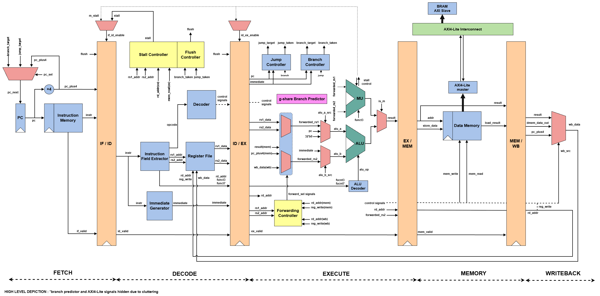

# 5-Stage Pipelined RISC-V SoC | RV32IM + AXI4-Lite

A 32-bit **RV32IM** processor implemented in Verilog with a classic **5-stage in-order pipeline** and an **AXI4-Lite data-memory subsystem**.

This project was built primarily to **learn** RISC-V processor architecture by implementing the datapath, control logic, hazards, forwarding, multi-cycle execution, dynamic branch prediction and FPGA integration stage by stage.

The processor has passed directed CPU + AXI4-Lite regression tests and has been synthesized, placed, and routed for a **Xilinx Artix-7** FPGA with timing met at **100 MHz**. An RV32I **Hamming(7,4) error-correction** program is also available as a practical software demonstration.

**Simplified Pipeline Block Diagram**  
*Implementation-specific control and datapath signals are omitted for clarity. The AXI4-Lite data-memory path is described separately below.*



## Pipeline Architecture

The processor follows a classic **5-stage in-order pipeline**: **IF → ID → EX → MEM → WB**, separated by the **IF/ID, ID/EX, EX/MEM, and MEM/WB** pipeline registers. The IF stage fetches the instruction and computes `PC + 4`; ID extracts instruction fields, generates immediates, reads the register file, and produces control signals; EX performs ALU operations, branch/jump resolution, forwarding, and RV32M execution; MEM issues and completes load/store requests through the LSU and AXI4-Lite bus; and WB selects the final result and writes it back to the register file.

Each pipeline register carries a **valid bit** alongside the instruction data and control signals. A cleared valid bit represents a bubble. Instruction flushing is handled by clearing the valid bit in the **IF/ID** and **ID/EX** pipeline registers, allowing stale pipeline contents to remain physically present without causing architectural side effects. Valid bits qualify actions such as register writes, memory writes, and control-flow redirects, and are used as part of the hazard handling for load-use stalls, branch/jump flushes, and multi-cycle RV32M execution.

Pipeline registers sample new data only when their **enable** signal is asserted; otherwise, they retain their previous contents. During a flush, the associated pipeline entry is marked invalid rather than requiring all stored data to be cleared. This stale payload may continue propagating through later stages with its valid bit cleared, ensuring that it cannot modify the register file, memory, or control flow.

## Hazard Handling

The processor handles the following pipeline hazards:

- **Data forwarding** from MEM and WB to EX that resolves RAW dependencies without stalling
- **Load-use stalling** when an instruction depends on load data that is not yet available
- **Branch/JAL/JALR redirect flushing** to invalidate younger wrong-path instructions
- **Multi-cycle RV32M stalling** while multiply/divide operations occupy the EX stage
- **AXI memory backpressure** that holds pipeline state until a load/store transaction completes

The processor handles most **RAW data hazards** using a forwarding network in the EX stage. Source register addresses in EX are compared against destination register addresses in MEM and WB, with **MEM given priority over WB** when both match. ALU results and `PC + 4` can be forwarded directly from MEM, while the final writeback value can be forwarded from WB. The forwarded operands are shared by the ALU, RV32M unit, branch comparator, JALR address calculation and store-data path. Loads are not forwarded from MEM because their memory data is not yet available.

A **load-use hazard** is detected when a valid load in EX writes a non-zero destination register required by the instruction currently in ID. In this case, the PC and IF/ID register are held while a bubble is injected into ID/EX. The load is allowed to continue through the pipeline, after which its result becomes available through WB forwarding. The register file also provides same-cycle WB-to-ID bypassing for values being written back while a dependent instruction is being decoded.

**Control hazards** are resolved in the EX stage. When a valid branch, JAL, or JALR redirects execution, the PC is updated to the target and the younger instructions in IF/ID and ID/EX are flushed by clearing their valid bits. Since branch redirects and architectural side effects are qualified by the pipeline valid state, stale wrong-path instruction payloads cannot redirect execution or modify processor state.

AXI4-Lite memory requests can take multiple cycles. The **LSU asserts `MEM_stall`** until the request has been accepted and its response received, holding the in-flight MEM instruction and younger pipeline stages. When the memory operation completes, its load result and status advance with the correct instruction into MEM/WB. A held WB entry is prevented from writing the register file repeatedly. Branch redirects and new RV32M operations are also gated during a memory stall.

RV32M instructions introduce a separate **multi-cycle EX stall**. While the iterative multiply/divide unit is busy, the PC, IF/ID, and ID/EX stages are held so the M instruction remains in EX, while older instructions already present in MEM and WB are allowed to drain. Advancement of another valid instruction into EX/MEM is suppressed until the M operation completes, after which normal pipeline execution and forwarding resume.

## Supported ISA

The core implements the **RV32IM** instruction set, consisting of the 32-bit base integer ISA (**RV32I**) together with the integer multiplication and division extension (**RV32M**).

### Supported ISA

| ISA | Category | Instructions |
|---|---|---|
| **RV32I** | Integer Arithmetic | `ADD`, `SUB`, `ADDI` |
|  | Logical | `AND`, `OR`, `XOR`, `ANDI`, `ORI`, `XORI` |
|  | Shifts | `SLL`, `SRL`, `SRA`, `SLLI`, `SRLI`, `SRAI` |
|  | Comparisons | `SLT`, `SLTU`, `SLTI`, `SLTIU` |
|  | Upper Immediate | `LUI`, `AUIPC` |
|  | Branches | `BEQ`, `BNE`, `BLT`, `BGE`, `BLTU`, `BGEU` |
|  | Jumps | `JAL`, `JALR` |
|  | Loads | `LB`, `LH`, `LW`, `LBU`, `LHU` |
|  | Stores | `SB`, `SH`, `SW` |
| **RV32M** | Multiply | `MUL`, `MULH`, `MULHSU`, `MULHU` |
|  | Divide | `DIV`, `DIVU` |
|  | Remainder | `REM`, `REMU` |

A total of 45 instructions.
(`FENCE`, `ECALL`, and `EBREAK` are **not supported**)

All eight instructions from the RISC-V **M extension** are supported:
RV32M operations are executed using a shared **iterative multi-cycle execution unit** in the EX stage rather than single-cycle combinational multipliers or dividers.

## Memory System

The core uses separate **instruction and data address spaces**, each currently **1024 × 32-bit words (4 KiB)**. Instruction fetch remains local to a synchronous, block-RAM-inferred instruction memory, while all CPU data loads and stores pass through the LSU and the AXI4-Lite data bus. The AXI4-Lite BRAM slave also infers FPGA Block RAM; the previous asynchronous, distributed-LUTRAM data-memory interface has been replaced.

The data path supports byte, halfword, and word accesses, with little-endian byte ordering. The LSU uses the lower address bits to select the required lanes, generates write strobes, and sign-extends or zero-extends load results.

| Operation | Supported Instructions |
|---|---|
| Byte Load | `LB`, `LBU` |
| Halfword Load | `LH`, `LHU` |
| Word Load | `LW` |
| Byte Store | `SB` |
| Halfword Store | `SH` |
| Word Store | `SW` |

The instruction memory initializes from **`program.mem`** using `$readmemh`. The image should contain valid RV32 instructions, with unused locations filled with `NOP` instructions (`ADDI x0, x0, 0`). Directed simulation testbenches can alternatively overwrite the instruction-memory array to load their own programs; such hierarchical writes are simulation-only.

A valid instruction-memory image should also be present during synthesis. An uninitialized or effectively constant program can allow Vivado to optimize away otherwise active logic and produce misleading utilization and timing results.

## AXI4-Lite Data Bus

The current data-memory subsystem uses a **single AXI4-Lite master and one BRAM slave**:

```text
CPU MEM stage
    | request, result, stall
Load/Store Unit (LSU)
    | request/response
AXI4-Lite Master
    | AW, W, B, AR, R
AXI4-Lite Interconnect
    | AW, W, B, AR, R
AXI4-Lite BRAM Slave (4 KiB)
```

- **LSU:** Checks byte/halfword/word alignment; word-aligns bus addresses; shifts store data into the correct byte lanes; generates `WSTRB`; extracts and sign/zero extends load data. Misaligned accesses are rejected locally without issuing a bus transaction.
- **AXI4-Lite master:** Converts LSU requests to AXI transactions, handles the independent write-address (`AW`) and write-data (`W`) handshakes, waits for the write-response (`B`) or read-data (`R`) channel, and returns the response to the LSU. It allows **one outstanding transaction** at a time.
- **Interconnect:** Routes requests for the implemented RAM window to the BRAM slave. Unmapped accesses return **`DECERR`** to the master; only the RAM slave is connected at this stage.
- **BRAM slave:** Implements 1024 × 32-bit memory words with byte-write enables and AXI4-Lite read/write responses. Normal mapped operations return **`OKAY`**.

| Property | Current Implementation |
|---|---|
| AXI address/data width | 32 / 32 bits |
| Write strobes | 4 bits (`WSTRB[3:0]`) |
| Data byte order | Little-endian |
| Mapped data range | `0x0000_0000`–`0x0000_0FFF` |
| Outstanding transactions | One |
| AXI channels | `AW`, `W`, `B`, `AR`, `R` |
| Clock/reset | Shared `clk` and synchronized, active-high `rst` |
| Unmapped response | `DECERR` (`2'b11`) |

**Error handling:** The LSU reports misalignment and AXI access faults, and faulting load instructions are prevented from writing a register result. Full architectural exception/trap handling is **not yet implemented**.

## FPGA Implementation
Results as of **31/10/2026** (CPU + AXI4-Lite SoC)

The design was synthesized, placed, and routed with **Vivado 2026.1** for the **Xilinx Artix-7 XC7A100T-CSG324-1** device. The routed implementation meets the **100 MHz** constraint (10 ns period) with no failing internal setup, hold, or pulse-width endpoints.

### Resource Utilization

| Resource | Used | Available | Utilization |
|---|---:|---:|---:|
| Slice LUTs | 2338 | 63400 | 3.69% |
| LUTs as Logic | 2254 | 63400 | 3.56% |
| LUTs as Distributed RAM | 84 | 19000 | 0.44% |
| Slice Registers | 1905 | 126800 | 1.50% |
| Slices | 917 | 15850 | 5.79% |
| F7 Muxes | 112 | 31700 | 0.35% |
| F8 Muxes | 8 | 15850 | 0.05% |
| Block RAM (RAMB36) | 2 | 135 | 1.48% |
| DSPs | 0 | 240 | 0.00% |
| BUFGCTRL | 1 | 32 | 3.13% |
| Bonded IOBs | 6 | 210 | 2.86% |

The updated processor uses **two 36 Kb Block RAM resources**, one for instruction memory and one for AXI4-Lite data memory. An additional 84 LUTs are inferred as distributed RAM for smaller internal storage structures.

The RV32M multiply/divide unit continues to use FPGA logic and registers rather than dedicated DSP blocks.

Despite the addition of the Load Store Unit, AXI4-Lite master, interconnect, and BRAM slave, the complete SoC occupies only **3.69% of available Slice LUTs**, **1.50% of Slice Registers**, and **1.48% of Block RAM tiles** on the Artix-7 XC7A100T.

*Utilization figures are from the fully placed design in Vivado 2026.1.*

### Timing

| Metric | Result |
|---|---:|
| Clock Frequency | **100 MHz** |
| Clock Period | **10.000 ns** |
| Worst Setup Slack (WNS) | **+0.227 ns** |
| Total Setup Violation (TNS) | **0.000 ns** |
| Worst Hold Slack (WHS) | **+0.037 ns** |
| Total Hold Violation (THS) | **0.000 ns** |
| Worst Pulse Width Slack (WPWS) | **+3.750 ns** |
| Failing Setup Endpoints | **0** |
| Failing Hold Endpoints | **0** |


### Implementation Notes

- The instruction ROM and AXI4-Lite data RAM infer **FPGA Block RAM**, replacing the earlier distributed-RAM data-memory arrangement.
- The external `raw_rst` input passes through a **two-flop reset synchronizer**; internal logic uses its synchronized active-high reset.
- The implementation report contains optional methodology warnings for RAM output-register optimization and missing input/output timing constraints on `raw_rst` and `debug_led[3:0]`. A separate XDC can constrain the asynchronous reset input path and exempt non-time-critical LED outputs; the reported timing results above are from the uploaded routed run, not a new run with modified constraints.
- The AXI interconnect currently maps only the data BRAM. Additional memory-mapped peripherals, such as GPIO, are future extensions rather than implemented slaves.
- Keep a valid `program.mem` image available when simulating and synthesizing the CPU to avoid uninitialized or optimized-away instruction logic.

